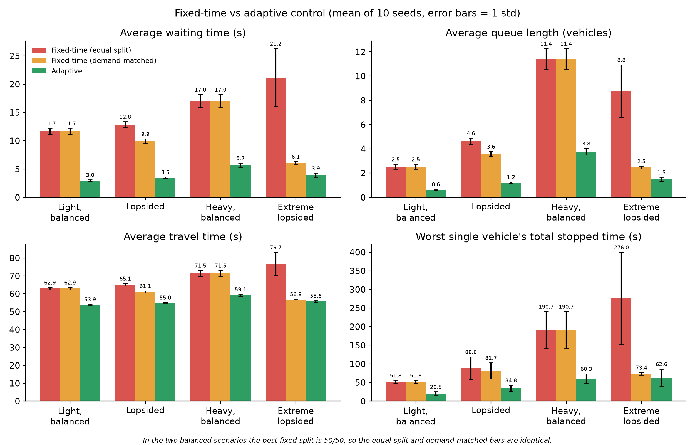
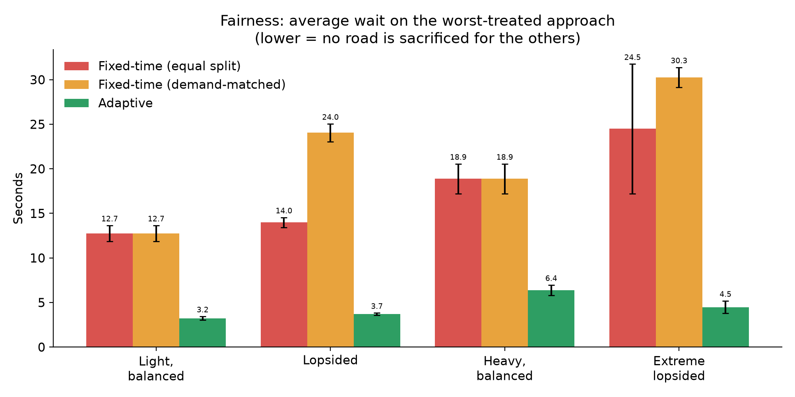

# Adaptive Traffic Signal Control Using Traffic-Demand and Waiting-Time Analysis with Emergency-Vehicle Preemption

A software traffic-signal controller for an isolated four-way intersection, evaluated in the [SUMO](https://eclipse.dev/sumo/) traffic simulator through its TraCI interface. It allocates green time from the queue and waiting time on each axis, guarantees that no approach is neglected, and gives emergency vehicles priority without breaking that guarantee.

Minor project, Department of CS&E, The National Institute of Engineering (NIE), Mysuru. This phase is **simulation-only**; calibration with field data and hardware sensing are planned next.

## Highlights

- **Adaptive controller:** each axis gets a priority score `P = Q + 0.05 W` (`Q` = queued vehicles, `W` = total waiting time in seconds).
- **Fairness by design:** a 60 s starvation limit bounds every approach's wait. Derived worst-case bound: 74 s (104 s with one capped emergency override), plus queue start-up delay.
- **Emergency preemption:** emergency vehicles within 150 m of the stop line get green. Each override is capped at 20 s and followed by a 10 s cooldown so fairness holds.
- **Fair comparison:** the controller is compared with an equal-split fixed-time plan *and* a demand-matched fixed-time plan, over 4 demand scenarios and 10 random seeds.

## Results (mean of 10 seeds, average waiting time in seconds)

| Scenario | Fixed, equal split | Fixed, demand-matched | **Adaptive** |
|---|---|---|---|
| Light, balanced | 11.67 | 11.67 | **2.96** |
| Lopsided | 12.85 | 9.91 | **3.47** |
| Heavy, balanced | 17.01 | 17.01 | **5.70** |
| Extreme lopsided | 21.18 | 6.11 | **3.86** |

- Waiting time falls 66-82% against the equal split, and 65% / 37% against the matched plan in the lopsided / extreme lopsided scenarios.
- The wait on the worst-treated approach is 85% lower than under the matched plan (3.7 s against 24.1 s in the lopsided scenario).
- Emergency vehicles: 0.0 s average wait with preemption against 10.8 s under fixed-time control.
- Stress test (ambulance every 10 s on the light road): longest continuous stop of a regular vehicle was 32 s with the cap, 87 s without.
- Throughput is demand-bound and unchanged: the benefit is lower delay, not extra capacity.




## Repository structure

```
sumo/
  intersection.net.xml      four-way junction, 2 lanes per direction, 300 m approaches
  sim.sumocfg               SUMO configuration
  routes.rou.xml            default lopsided demand (evenly spaced arrivals)
  scenarios/                route files for the demand scenarios (random arrivals)
src/
  run_sim.py                controllers (fixed, demand-matched, adaptive), simulation loop, metrics
  scenarios.py              scenario generation and emergency-vehicle flows
  experiments.py            main comparison: 4 scenarios x 3 controllers x 10 seeds
  emergency_demo.py         emergency-preemption validation
  sweep.py                  sensitivity analysis (wait weight x switching margin)
  stress_test.py            emergency stress test (with and without the cap)
  screenshots.py            captures SUMO-GUI screenshots
  plots.py                  result figures
  baseline.py               early fixed-time baseline
results/                    CSV results and plots
dashboard.html              replay dashboard (open in a browser)
simulator.html              interactive browser demo (simplified re-implementation of the rules)
```

## Requirements

- [Eclipse SUMO](https://eclipse.dev/sumo/) (developed with 1.27.1) with the `SUMO_HOME` environment variable set
- Python 3 (developed with 3.14) with `pandas` and `matplotlib`

```bash
pip install pandas matplotlib
```

Set `SUMO_HOME` to your SUMO installation, for example:

```bash
# Windows (PowerShell)
setx SUMO_HOME "C:\Program Files (x86)\Eclipse\Sumo"
# Linux
export SUMO_HOME=/usr/share/sumo
```

The scripts add `$SUMO_HOME/tools` to the Python path to import `traci`, and exit with a message if `SUMO_HOME` is not set.

## Quick start

Run a single simulation (`fixed`, `tuned` for the demand-matched plan, or `adaptive`) with a seed and print its metrics:

```bash
python src/run_sim.py adaptive 42
```

Watch it in SUMO-GUI:

```bash
cd src
python -c "import run_sim; run_sim.run('adaptive', gui=True, save=False)"
```

Reproduce the results (each script writes CSV files to `results/`):

```bash
python src/experiments.py        # main comparison (10 seeds)
python src/emergency_demo.py     # emergency preemption
python src/sweep.py              # sensitivity analysis
python src/stress_test.py        # emergency stress test
python src/plots.py              # figures
```

## How the controller works

Every simulated second the controller reads the queue and waiting time on the north-south and east-west axes. After the 10 s minimum green, it switches (through a 3 s yellow) if any of these holds:

1. a vehicle on the red axis has waited 60 s or more (starvation limit);
2. the green has lasted 60 s and vehicles are queued on the red axis (maximum green);
3. the red axis score exceeds 1.5 times the green axis score plus 1.

| Parameter | Value |
|---|---|
| Minimum / maximum green | 10 s / 60 s |
| Yellow | 3 s |
| Starvation limit | 60 s |
| Wait weight | 0.05 |
| Switch margin | 1.5 x + 1 |
| Emergency detection range | 150 m |
| Override cap / cooldown | 20 s / 10 s |

Minimum green, maximum green and yellow follow the Indian Roads Congress guidelines (IRC:93-1985). Results change by at most about 8% across the tested range of the wait weight (0.02 to 0.10) and the switch margin (1.2 to 2.0).

## Notes

- Experiments use random arrivals (a vehicle enters each approach with a probability set by its hourly flow). The default `sumo/routes.rou.xml` uses evenly spaced arrivals at the same hourly flows, so a single run with it gives lower waits than the 10-seed averages above.
- `simulator.html` is a simplified browser demonstration. The reported results come from SUMO runs.

<p align="center">Designed and Implemented by <a href="https://github.com/dewanshi-goel">Dewanshi</a></p>
